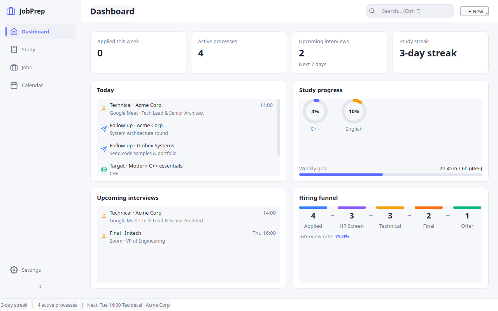
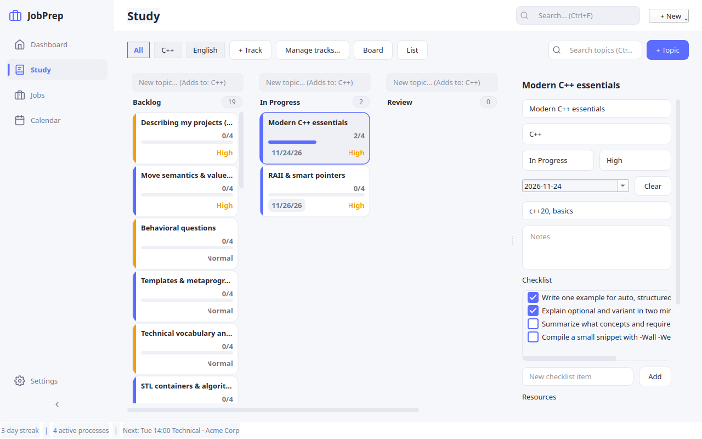
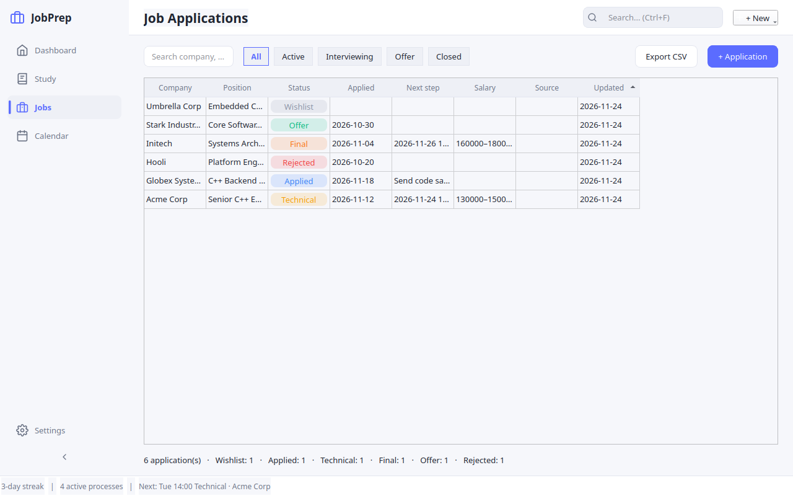
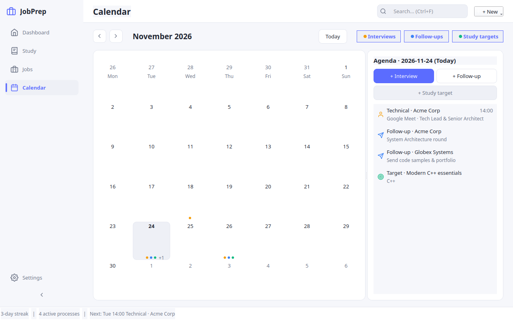
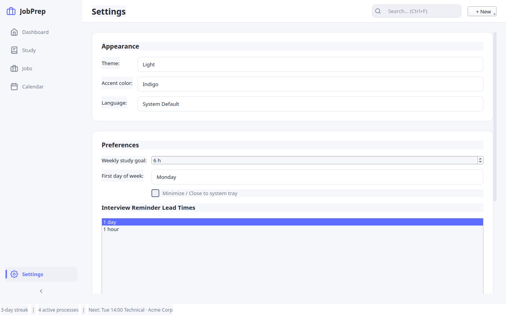
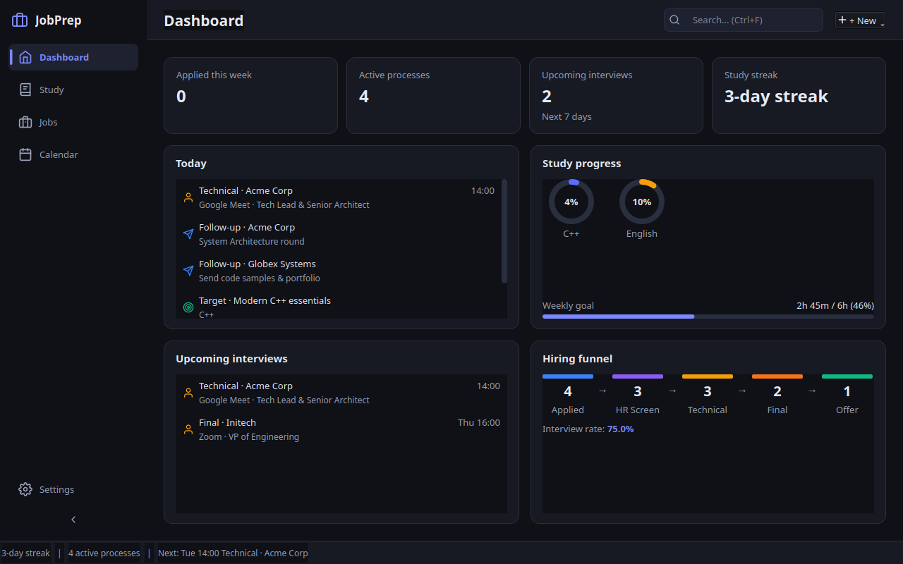

# JobPrep

Offline desktop application for planning interview preparation and tracking job applications, built with C++20 and Qt 6 Widgets.

[](https://github.com/TonyTryHard/JobPrep/actions/workflows/ci.yml)


---

## What It Is

JobPrep is a single-user personal desktop application designed to structure technical interview preparation and track job opportunities in one focused workspace. It runs completely offline using a local SQLite database—no remote servers, no user accounts, and no background telemetry (external URLs in job applications or study topics open in your standard system web browser on click).

### Core Features

- **Preparation Tracks & Topics**: Built-in C++ and English study tracks with customizable topics, priority ratings, target completion dates, external resources, and subtask checklists.
- **Kanban Board & List Views**: Manage study topics across progression columns (*Backlog*, *In Progress*, *Review*, *Done*) with subtask counters, or switch to a sortable tabular view.
- **Study Session Logging & Goals**: Record individual study sessions with minute precision and track cumulative weekly progress against an adjustable study target (default: 6 hours).
- **Application Pipeline**: Track job applications through stages (*Wishlist*, *Applied*, *HR Screen*, *Technical*, *Final*, *Offer*, *Accepted*, *Rejected*, *Withdrawn*, *Ghosted*) with salary ranges, work modes, and follow-up deadlines.
- **Interview Tracking**: Log interview rounds (*HR*, *Technical*, *Live Coding*, *System Design*, *Behavioral*, *Final*) with date, duration, interviewer, outcome, and meeting notes.
- **Unified Calendar & Agenda**: Month view with color-coded markers for scheduled interviews, application follow-ups, and study target dates, paired with a daily agenda list.
- **Reminders & System Tray Notifications**: Background reminder service for upcoming interviews (with configurable lead times, default: 24 hours and 1 hour) and due follow-up actions, with system tray alerts or automatic in-app toast fallbacks if the system tray is unavailable.
- **Data Portability & Safety**: Full database backup and restore via a single JSON archive, featuring automatic pre-restore safety backups. Direct export of job applications to CSV (22 standard columns: Company, Position, Status, Applied, Next step, Salary, Source, Updated, URL, Resume version, Location, Work mode, Salary min, Salary max, Currency, Next action, Next action date, Contact name, Contact email, Notes, Created at, Updated at) and scheduled interviews to iCalendar (`.ics`).
- **Starter Sample Data**: Optional built-in starter dataset covering modern C++ and English technical interview topics with subtask checklists.

---

## Screenshots

| Dashboard (Light Theme) | Study Kanban & Checklist |
| :---: | :---: |
|  |  |

| Job Applications | Calendar & Agenda |
| :---: | :---: |
|  |  |

| Settings & Preferences | Dashboard (Dark Theme) |
| :---: | :---: |
|  |  |

---

## Languages and Themes

- **Languages**: Complete user interface localization for English (source), Ukrainian (`Українська`), and Russian (`Русский`), covering all UI strings with correct Slavic plural forms (`%n`). The application defaults to the system UI locale on first launch. Language can be changed in **Settings** and applies on next application startup.
- **Themes**: Full Light and Dark mode support, paired with 6 accent color presets (Indigo, Teal, Rose, Amber, Emerald, Sky). Themes switch instantly at runtime without restart.

---

## Quick Start

### Requirements

- **C++20 Compiler**: A C++20 compiler (CI uses GCC on `ubuntu-latest` and MSVC 2022 on `windows-latest`).
- **CMake**: Version >= 3.21
- **Build Tool**: Ninja
- **Qt 6**: Version **6.8 LTS** or newer (with modules `Core`, `Gui`, `Widgets`, `Sql`, `Svg`, `Test`, `LinguistTools`)

### Linux Build

Install dependencies on Ubuntu / Debian (as in CI):

```bash
sudo apt-get install -y --no-install-recommends ninja-build libgl1-mesa-dev libfontconfig1 libdbus-1-3 libxkbcommon0 libxkbcommon-x11-0 fonts-dejavu-core
```

Configure, build, and run using CMake presets:

```bash
export QT_PREFIX_PATH="/path/to/Qt/6.8.x/gcc_64"  # Omit if using system Qt 6.8+
cmake --preset dev-linux
cmake --build --preset dev-linux
ctest --preset dev-linux --output-on-failure

# Launch the application
./build/dev-linux/jobprep
```

### Windows Build

Open the **x64 Native Tools Command Prompt for VS 2022**:

```cmd
set PATH=%QT_PREFIX_PATH%\bin;%PATH%

cmake --preset dev-windows
cmake --build --preset dev-windows
ctest --preset dev-windows --output-on-failure

:: Launch the application
.\build\dev-windows\jobprep.exe
```

For detailed platform notes, toolset requirements, and troubleshooting, see [docs/RUNNING.md](docs/RUNNING.md).

---

## Running and Data Storage

### Where Data Lives

JobPrep stores user data in standard OS locations (`QStandardPaths::AppDataLocation` with organization `JobPrep` and application `JobPrep`):

- **Database**:
  - Linux: `${XDG_DATA_HOME:-~/.local/share}/JobPrep/JobPrep/jobprep.sqlite`
  - Windows: `%APPDATA%\JobPrep\JobPrep\jobprep.sqlite` *(derived from code, not run on Windows)*
- **Settings**:
  - Linux: `${XDG_CONFIG_HOME:-~/.config}/JobPrep/JobPrep.conf`
  - Windows: Registry `HKEY_CURRENT_USER\Software\JobPrep\JobPrep`
- **Safety Backups**:
  - Linux: `${XDG_DATA_HOME:-~/.local/share}/JobPrep/JobPrep/backups/pre-restore-<timestamp>.json`
  - Windows: `%APPDATA%\JobPrep\JobPrep\backups\pre-restore-<timestamp>.json` *(derived from code, not run on Windows)*

> **Note**: Development builds and deployed copies share the same local database on disk.

### Running in Complete Isolation

To test or demo the application in isolation without reading or writing to your real database:

```bash
# Linux (isolated temporary HOME and XDG data/config folders)
HOME=/tmp/jp-isolated XDG_DATA_HOME=/tmp/jp-isolated/.local/share XDG_CONFIG_HOME=/tmp/jp-isolated/.config ./build/dev-linux/jobprep
```

On Windows, the application data directory is resolved via the Windows shell API and cannot be redirected using environment variables; back up your database first (**Settings** -> **Data** -> **Backup**) before running a development build.

### Windows Deployment Recipe

To bundle JobPrep for distribution using `windeployqt` (maintainer recipe, not part of CI):

```cmd
:: Open the "x64 Native Tools Command Prompt for VS 2022"
set QT_PREFIX_PATH=<path to your Qt kit, e.g. C:\Qt\6.8.2\msvc2022_64>.
set PATH=%QT_PREFIX_PATH%\bin;%PATH%

:: Release build using Ninja
cmake -B build/release -G Ninja -DCMAKE_BUILD_TYPE=Release
cmake --build build/release --target jobprep

:: Bundle runtime dependencies with windeployqt
mkdir deploy && copy build\release\jobprep.exe deploy\
windeployqt --release deploy\jobprep.exe
```

> **Note**: This is the maintainer's deployment recipe, not part of CI. The recipe starts from the "x64 Native Tools Command Prompt for VS 2022" (needed for the build only, not for running the result). The deployed folder runs by double-clicking `jobprep.exe` without Qt on `PATH`. `CMakePresets.json` configures a Debug build by default (`dev-windows`); building for distribution uses an explicit Release build directory as shown above.

---

## Keyboard Shortcuts

| Shortcut | Context | Action |
| :--- | :--- | :--- |
| `Ctrl+1` | Global | Switch to Dashboard (Home) |
| `Ctrl+2` | Global | Switch to Study |
| `Ctrl+3` | Global | Switch to Job Applications |
| `Ctrl+4` | Global | Switch to Calendar |
| `Ctrl+,` | Global | Open Preferences (Settings) |
| `Ctrl+N` | Global | Create new item on active page (Session on Home, Topic on Study, Application on Jobs, Interview on Calendar) |
| `Ctrl+F` | Global | Focus search / filter field on active page |
| `Ctrl+S` | Dialogs & Panels | Save changes in detail panels or modal dialogs |
| `Esc` | Global | Close open dialog, dismiss details panel, close calendar popup, or clear active search |
| `Alt+Down` / `F4` | Date fields | Open calendar date picker popup |

For detailed shortcut behaviors and focus handling, see [docs/SPEC.md §3.7](docs/SPEC.md#37-global).

---

## Project Layout and Architecture

### Directory Tree

```
JobPrep/
├── CMakeLists.txt        # Top-level build configuration and compiler warning flags
├── CMakePresets.json     # Configure, build, and test presets for Linux and Windows
├── resources/            # Icons (SVG), stylesheets (QSS), translations (.ts/.qm), fonts, seed JSON
├── src/
│   ├── app/              # Composition root and initialization (AppContext, Resources, Localization)
│   ├── domain/           # Pure value types, domain structs, and enums (no SQL, no widgets)
│   ├── data/             # SQLite database layer, schema migrations, and typed repositories
│   ├── services/         # Business services (Stats, Agenda, Reminders, Import/Export, Seed)
│   ├── models/           # Qt item models (QAbstractItemModel) and sort/filter proxies
│   ├── ui/               # MainWindow, sidebar, pages, dialogs, custom widgets, delegates, and theme
│   └── platform/         # OS-specific platform abstractions
├── tests/                # Headless Qt Test suites for data, services, models, shortcuts, UI smoke, and i18n
└── scripts/              # Quality gate (check.sh, check.ps1) and translation sync scripts
```

### Architecture

JobPrep follows a strict unidirectional dependency architecture: `ui -> models -> services -> data -> domain`.
The domain layer defines pure value types and enums without database or widget dependencies.
The data layer encapsulates all SQLite operations within typed repositories and schema migrations, notifying observers via signals on mutations.
The composition root (`AppContext`) owns the lifecycle of repositories and services, injecting them by reference without singletons or global state.

---

## Testing and Quality Gate

### Running Local Tests

Before committing changes, run the quality gate script for your platform:

```bash
# Linux
./scripts/check.sh

# Windows (PowerShell)
.\scripts\check.ps1
```

The script configures, builds with zero compiler warnings (`-Werror` / `/WX`), executes all 35 headless Qt Test suites with `QT_QPA_PLATFORM=offscreen`, and verifies translation catalog synchronization via `scripts/check-translations.sh`.

### Continuous Integration

The repository enforces quality via GitHub Actions (`.github/workflows/ci.yml`):
- `Gate (ubuntu-latest, Qt 6.8.2)`: Verifies LTS compatibility on Linux with GCC.
- `Gate (ubuntu-latest, Qt 6.10.3)`: Verifies current Qt 6.10 compatibility on Linux.
- `Gate (windows-latest, Qt 6.10.3)`: Verifies MSVC 2022 compatibility on Windows.
- `Gate (windows-latest, Qt 6.8.2 compat)`: Scheduled weekly check for Qt 6.8 LTS on Windows.

### Specialized Test Suites

- **UI Smoke Test (`ui_smoke`)**: Instantiates `MainWindow`, navigates every page, switches themes, opens modal dialogs, and verifies zero unexpected `qWarning`/`qCritical` output.
- **Translations (`tst_Translations`)**: Validates XML structure, translation completeness (zero unfinished strings), placeholder parity (`%1`..`%9`), HTML tag parity, and plural handling (`%n`).
- **HiDPI and Layout (`tst_HiDpi`)**: Verifies zero widget clipping or text overlap at 100% and 150% display scaling under English, Ukrainian, Russian, and expanded pseudo-translation text across light and dark themes.

---

## Status and Scope

JobPrep is a working application; all five pages are implemented and covered by the test suites; CI runs on Linux and Windows. The application is localized in English, Ukrainian, and Russian.

### Known Limitations & Out of Scope

- **Single-User Local Storage**: All data resides in local SQLite; there is no cloud synchronization or multi-device account sync.
- **Language Switch Restart**: Language selection requires an application restart because Qt installs translation catalogs prior to GUI widget creation.
- **Windows Dialog Buttons**: Standard dialog button translations (*OK*, *Cancel*, *Yes*, *No*) on Windows rely on `qtbase_uk.qm` and `qtbase_ru.qm` being present in `%QT_PREFIX_PATH%\translations` or alongside the executable.
- **Keyboard Accelerators**: Custom mnemonic accelerators are not defined for Ukrainian and Russian; standard dialog buttons use Qt's built-in translations, and field navigation uses Tab, Shift+Tab, Enter, and Esc.

---

## Contributing

Contributions, feedback, and suggestions are welcome!
- **Discussions & Issues**: If you run into an issue, have a question, or would like to propose an enhancement, feel free to open an issue on the repository issue tracker.
- **Pull Requests**: When submitting a pull request, please ensure that changes follow the unidirectional architecture, adhere to the coding conventions in `AGENTS.md`, and pass `./scripts/check.sh` (or `.\scripts\check.ps1` on Windows) with zero warnings and all tests green.
