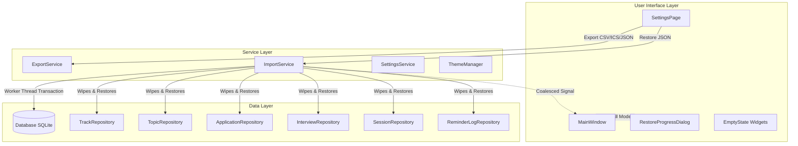
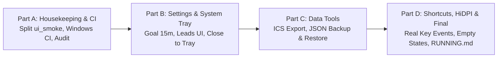

# Milestone 6 Plan: Polish & Data Tools

- **Date:** 2026-10-26
- **Status:** PLAN ONLY (Awaiting User Review and Approval)
- **Document Version:** 1.0

---

## 1. Environment Line

Information collected via active session commands:

```
$ lsb_release -d && uname -r && g++ --version | head -1
Description:	Ubuntu 26.04.1 LTS
7.0.0-38-generic
g++ (Ubuntu 15.2.0-16ubuntu1) 15.2.0

$ ./build/dev-linux/tests/ui_smoke/ui_smoke | head -2 | grep "Config:"
Config: Using QtTest library 6.10.2, Qt 6.10.2 (x86_64-little_endian-lp64 shared (dynamic) release build; by GCC 15.2.0), ubuntu 26.04
```

- **Host OS & Distribution:** Ubuntu 26.04.1 LTS x86_64
- **Kernel:** Linux `7.0.0-38-generic`
- **Compiler:** GCC `15.2.0` (`-std=c++20 -Wall -Wextra -Wpedantic -Werror`)
- **Qt Version:** Qt `6.10.2` (system packages, GCC 15.2.0 64-bit)
- **Target OS Matrix:** Linux x86_64 (GCC 11+, X11/Wayland) and Windows 10/11 x64 (MSVC 2022)

---

## 2. Pre-Flight Codebase Findings

The following table reflects verified facts established by direct command execution in this session:

| Topic | Pre-Flight Status & Evidence | Command Used |
|---|---|---|
| **`SettingsPage` & Sidebar** | `SettingsPage` exists in `src/ui/pages/SettingsPage.{h,cpp}` with Appearance (theme, accent) and partial Preferences (study goal as integer hour spinbox, week start combo, close to tray checkbox). Sidebar item exists at index 4 (`settingsBtn`). Missing: Data section, Reminder lead times UI, 15-minute goal resolution, tray availability checks. | `grep -n "SettingsPage\|Settings" src/ui/pages/SettingsPage.* src/ui/Sidebar.* src/ui/MainWindow.*` |
| **`SettingsService` Keys & Signals** | Keys: `windowGeometry`, `windowState`, `isSidebarCollapsed`, `themeMode`, `accentPreset`, `weeklyGoalMinutes`, `firstDayOfWeek`, `interviewLeadMinutes`, `closeToTray`, `sampleDataPrompted`, calendar layers, splitter states, study view mode/filter. All corresponding change signals are present. | `grep -n "Q_SIGNAL\|signals:\|void set\|() const" src/services/SettingsService.h` |
| **`ExportService` & `ImportService`** | `ExportService` currently only contains `headers()` and `exportToFile()` for CSV applications export. `ImportService` does **not** exist yet. | `ls -la src/services/ExportService.* src/services/ImportService.* 2>&1` |
| **`SeedService` & Sample Prompt** | `SeedService` implements `loadSampleTopics()`. `main.cpp` prompts on first launch when `!sampleDataPrompted() && isDataEmpty()`. | `grep -n -C 5 "sampleDataPrompted\|SeedService" src/main.cpp src/services/SeedService.*` |
| **App Icon & `app.svg`** | `resources/icons/app.svg` exists. `setWindowIcon` is **not** called anywhere in `src/`. | `ls -la resources/icons/app.svg && grep -rn "setWindowIcon" src/` |
| **`src/platform/`** | Directory exists and contains only `.gitkeep`. No `Q_OS_*` defines exist outside `src/platform/`. | `ls -la src/platform/ && grep -rn "Q_OS_" src/` |
| **CMake & Windows Flags** | `CMakeLists.txt` sets `/W4 /permissive-` and `/WX` for MSVC. `add_executable(jobprep ...)` lacks `WIN32` flag (currently builds console subsystem). | `grep -n -C 5 "MSVC\|WIN32\|add_executable(jobprep" CMakeLists.txt` |
| **CI & `docs/RUNNING.md`** | Neither `.github/` nor `docs/RUNNING.md` exists yet. | `ls -la .github/ docs/RUNNING.md 2>&1` |
| **Action & Shortcut Bindings** | `MainWindow` sets `Ctrl+1..4`, `Preferences` (Ctrl+,), `Find` (Ctrl+F), `New` (Ctrl+N). `TopicDetailPanel` sets `Save` (Ctrl+S). Shortcuts are currently invoked directly in tests via method calls rather than real `QKeyEvent` dispatches. | `grep -rn "QShortcut\|QAction\|QKeySequence" src/` |
| **`setTabOrder` Usage** | Currently used exclusively in `TrackDialog.cpp`. All other dialogs and pages rely on default creation-order tab focus. | `grep -rn "setTabOrder" src/ui` |
| **Data Folder & DB Path** | Database path defaults to `QStandardPaths::writableLocation(QStandardPaths::AppDataLocation) + "/jobprep.sqlite"`. | `grep -rn "QStandardPaths\|jobprep.sqlite\|databasePath" src/` |
| **Background Threading** | Neither `QtConcurrent` nor `QThread` is used in `src/`. Import/restore operations need background execution. | `grep -rn "QtConcurrent\|QThread" src/ CMakeLists.txt` |
| **`reminders_sent` Bookkeeping** | Managed by `ReminderLogRepository`. Keys track delivered interview leads and follow-up dates. Table is omitted from JSON backups; restore must wipe it to prevent suppression of restored interview alerts. | `grep -rn "reminders_sent\|ReminderLogRepository" src/data/` |
| **Test Binaries & Functions** | Exactly 25 test binaries and 324 total test functions exist. `ui_smoke` contains 80 functions across 4,263 lines and runs for ~99 seconds. | `wc -l tests/ui_smoke/tst_UiSmoke.cpp && total=0; for t in build/dev-linux/tests/*/*; do ...; done` |
| **Scripts** | `scripts/check.sh`, `scripts/check.ps1`, `scripts/screenshots.sh`, and `scripts/screenshots.ps1` exist. | `ls -la scripts/` |

---

## 3. Raw Evidence for Codebase Claims

### 1. `SettingsPage` and Sidebar Wiring
```
$ grep -n "SettingsPage\|Settings" src/ui/pages/SettingsPage.* src/ui/Sidebar.* src/ui/MainWindow.*
src/ui/pages/SettingsPage.cpp:1:#include "ui/pages/SettingsPage.h"
src/ui/pages/SettingsPage.cpp:13:#include "services/SettingsService.h"
src/ui/pages/SettingsPage.cpp:21:SettingsPage::SettingsPage(Services::SettingsService& settings,
src/ui/pages/SettingsPage.cpp:24:    : PageBase(tr("Settings"), parent), m_settings(settings), m_themeMgr(themeMgr) {
src/ui/pages/SettingsPage.cpp:26:    loadSettings();
src/ui/pages/SettingsPage.cpp:29:void SettingsPage::setupUi() {
src/ui/pages/SettingsPage.cpp:134:void SettingsPage::loadSettings() {
src/ui/pages/SettingsPage.h:10:class SettingsService;
src/ui/pages/SettingsPage.h:20:class SettingsPage : public PageBase {
src/ui/pages/SettingsPage.h:24:    explicit SettingsPage(Services::SettingsService& settings,
src/ui/pages/SettingsPage.h:27:    ~SettingsPage() override = default;
src/ui/pages/SettingsPage.h:31:    void loadSettings();
src/ui/pages/SettingsPage.h:33:    Services::SettingsService& m_settings;
src/ui/Sidebar.cpp:159:    // Settings at bottom
src/ui/Sidebar.cpp:160:    auto* settingsBtn = new NavButton(u"settings"_s, tr("Settings"), m_themeMgr, this);
src/ui/Sidebar.cpp:163:    m_navItems.append({settingsBtn, u"settings"_s, tr("Settings"), 4});
src/ui/MainWindow.cpp:19:#include "services/SettingsService.h"
src/ui/MainWindow.cpp:28:#include "ui/pages/SettingsPage.h"
src/ui/MainWindow.cpp:153:    m_pages.append(new Pages::SettingsPage(m_ctx.settings(), m_ctx.themeManager(), m_pageStack));
src/ui/MainWindow.cpp:192:    // Ctrl+1 through Ctrl+4 for main pages, Ctrl+, for Settings
```

### 2. `SettingsService` Keys and Signals
```
$ grep -n "Q_SIGNAL\|signals:\|void set\|() const" src/services/SettingsService.h
21:    QByteArray windowGeometry() const;
22:    void setWindowGeometry(const QByteArray& geometry);
24:    QByteArray windowState() const;
25:    void setWindowState(const QByteArray& state);
27:    bool isSidebarCollapsed() const;
28:    void setSidebarCollapsed(bool collapsed);
30:    QString themeMode() const;
31:    void setThemeMode(const QString& mode);
33:    QString accentPreset() const;
34:    void setAccentPreset(const QString& preset);
36:    int weeklyGoalMinutes() const;
37:    void setWeeklyGoalMinutes(int minutes);
39:    int firstDayOfWeek() const;
40:    void setFirstDayOfWeek(int day);
42:    QList<int> interviewLeadMinutes() const;
43:    void setInterviewLeadMinutes(const QList<int>& minutes);
45:    bool closeToTray() const;
46:    void setCloseToTray(bool enabled);
48:    bool sampleDataPrompted() const;
49:    void setSampleDataPrompted(bool prompted);
51:    bool calendarLayerInterviews() const;
52:    void setCalendarLayerInterviews(bool enabled);
54:    bool calendarLayerFollowUps() const;
55:    void setCalendarLayerFollowUps(bool enabled);
57:    bool calendarLayerTargets() const;
58:    void setCalendarLayerTargets(bool enabled);
60:    QByteArray calendarSplitterState() const;
61:    void setCalendarSplitterState(const QByteArray& state);
63:    QByteArray studySplitterState() const;
64:    void setStudySplitterState(const QByteArray& state);
66:    QString studyViewMode() const;
67:    void setStudyViewMode(const QString& mode);
69:    int studyTrackFilter() const;
70:    void setStudyTrackFilter(int trackId);
72:signals:
73:    void themeModeChanged(const QString& mode);
74:    void accentPresetChanged(const QString& preset);
75:    void sidebarCollapsedChanged(bool collapsed);
76:    void weeklyGoalMinutesChanged(int minutes);
77:    void firstDayOfWeekChanged(int day);
78:    void interviewLeadMinutesChanged(const QList<int>& minutes);
79:    void closeToTrayChanged(bool enabled);
80:    void calendarLayerInterviewsChanged(bool enabled);
81:    void calendarLayerFollowUpsChanged(bool enabled);
82:    void calendarLayerTargetsChanged(bool enabled);
83:    void studySplitterStateChanged(const QByteArray& state);
84:    void studyViewModeChanged(const QString& mode);
85:    void studyTrackFilterChanged(int trackId);
```

### 3. Check for `ImportService` and `ExportService`
```
$ ls -la src/services/ExportService.* src/services/ImportService.* 2>&1
ls: cannot access 'src/services/ImportService.*': No such file or directory
-rw-rw-r-- 1 tony tony 2940 Oct  5 08:56 src/services/ExportService.cpp
-rw-rw-r-- 1 tony tony 1734 Oct  5 08:55 src/services/ExportService.h
```

### 4. Check for Window Icon Calls
```
$ grep -rn "setWindowIcon" src/
```
*(Command exited with return code 1; no matches found).*

### 5. Check for `setTabOrder`
```
$ grep -rn "setTabOrder" src/ui
src/ui/dialogs/TrackDialog.cpp:187:        QWidget::setTabOrder(m_nameEdit, m_swatchButtons.first());
src/ui/dialogs/TrackDialog.cpp:189:            QWidget::setTabOrder(m_swatchButtons[i], m_swatchButtons[i + 1]);
src/ui/dialogs/TrackDialog.cpp:191:        QWidget::setTabOrder(m_swatchButtons.last(), m_customSwatchBtn);
src/ui/dialogs/TrackDialog.cpp:192:        QWidget::setTabOrder(m_customSwatchBtn, m_deleteBtn);
```

### 6. Check for Background Threading
```
$ grep -rn "QtConcurrent\|QThread" src/ CMakeLists.txt
```
*(Command exited with return code 1; no matches found).*

### 7. Check for `QSignalBlocker` and `blockSignals`
```
$ grep -rn "QSignalBlocker\|blockSignals" src
src/ui/widgets/TopicBoardColumn.cpp:13:#include <QSignalBlocker>
src/ui/widgets/TopicBoardColumn.cpp:183:        const QSignalBlocker blocker(m_list->selectionModel());
src/ui/widgets/TopicBoardColumn.cpp:200:    const QSignalBlocker blocker(m_quickAdd);
src/ui/widgets/TopicBoardColumn.cpp:297:    const QSignalBlocker blocker(m_quickAdd);
src/ui/widgets/TopicDetailPanel.cpp:315:    const QSignalBlocker blocker(m_trackCombo);
src/ui/widgets/TopicDetailPanel.cpp:499:        const QSignalBlocker blocker(m_titleEdit);
src/ui/widgets/TopicDetailPanel.cpp:555:        const QSignalBlocker blocker(m_titleEdit);
src/ui/widgets/TopicDetailPanel.cpp:559:        const QSignalBlocker blocker(m_trackCombo);
src/ui/widgets/TopicDetailPanel.cpp:568:        const QSignalBlocker blocker(m_statusCombo);
src/ui/widgets/TopicDetailPanel.cpp:575:        const QSignalBlocker blocker(m_priorityCombo);
src/ui/widgets/TopicDetailPanel.cpp:583:        const QSignalBlocker blocker(m_dateEdit);
src/ui/widgets/TopicDetailPanel.cpp:591:        const QSignalBlocker blocker(m_tagsEdit);
src/ui/widgets/TopicDetailPanel.cpp:595:        const QSignalBlocker blocker(m_notesEdit);
src/ui/widgets/TopicDetailPanel.cpp:706:        const QSignalBlocker blocker(m_dateEdit);
src/ui/dialogs/InterviewDialog.cpp:13:#include <QSignalBlocker>
src/ui/dialogs/InterviewDialog.cpp:193:    const QSignalBlocker blocker(m_appCombo);
src/ui/dialogs/InterviewDialog.cpp:227:    const QSignalBlocker appBlocker(m_appCombo);
src/ui/dialogs/InterviewDialog.cpp:228:    const QSignalBlocker dateBlocker(m_dateEdit);
src/ui/dialogs/InterviewDialog.cpp:229:    const QSignalBlocker timeBlocker(m_timeEdit);
src/ui/dialogs/InterviewDialog.cpp:230:    const QSignalBlocker durationBlocker(m_durationSpin);
src/ui/dialogs/InterviewDialog.cpp:231:    const QSignalBlocker typeBlocker(m_typeCombo);
src/ui/dialogs/InterviewDialog.cpp:232:    const QSignalBlocker outcomeBlocker(m_outcomeCombo);
src/ui/dialogs/InterviewDialog.cpp:233:    const QSignalBlocker placeBlocker(m_placeEdit);
src/ui/dialogs/InterviewDialog.cpp:234:    const QSignalBlocker interviewerBlocker(m_interviewerEdit);
src/ui/dialogs/InterviewDialog.cpp:235:    const QSignalBlocker notesBlocker(m_notesEdit);
src/ui/dialogs/ApplicationDialog.cpp:15:#include <QSignalBlocker>
src/ui/dialogs/ApplicationDialog.cpp:321:    const QSignalBlocker companyBlocker(m_companyEdit);
src/ui/dialogs/ApplicationDialog.cpp:322:    const QSignalBlocker positionBlocker(m_positionEdit);
src/ui/dialogs/ApplicationDialog.cpp:323:    const QSignalBlocker statusBlocker(m_statusCombo);
src/ui/dialogs/ApplicationDialog.cpp:324:    const QSignalBlocker sourceBlocker(m_sourceCombo);
src/ui/dialogs/ApplicationDialog.cpp:325:    const QSignalBlocker workModeBlocker(m_workModeCombo);
src/ui/dialogs/ApplicationDialog.cpp:326:    const QSignalBlocker salaryMinBlocker(m_salaryMinSpin);
src/ui/dialogs/ApplicationDialog.cpp:327:    const QSignalBlocker salaryMaxBlocker(m_salaryMaxSpin);
src/ui/dialogs/ApplicationDialog.cpp:328:    const QSignalBlocker currencyBlocker(m_currencyEdit);
src/ui/dialogs/ApplicationDialog.cpp:329:    const QSignalBlocker appliedBox(m_appliedDateEnabled);
src/ui/dialogs/ApplicationDialog.cpp:330:    const QSignalBlocker appliedDate(m_appliedDateEdit);
src/ui/dialogs/ApplicationDialog.cpp:331:    const QSignalBlocker nextActionBlocker(m_nextActionEdit);
src/ui/dialogs/ApplicationDialog.cpp:332:    const QSignalBlocker nextActionBox(m_nextActionDateEnabled);
src/ui/dialogs/ApplicationDialog.cpp:333:    const QSignalBlocker nextActionDate(m_nextActionDateEdit);
src/ui/dialogs/ApplicationDialog.cpp:334:    const QSignalBlocker urlBlocker(m_urlEdit);
src/ui/dialogs/ApplicationDialog.cpp:335:    const QSignalBlocker resumeBlocker(m_resumeVersionEdit);
src/ui/dialogs/ApplicationDialog.cpp:336:    const QSignalBlocker locationBlocker(m_locationEdit);
src/ui/dialogs/ApplicationDialog.cpp:337:    const QSignalBlocker contactNameBlocker(m_contactNameEdit);
src/ui/dialogs/ApplicationDialog.cpp:338:    const QSignalBlocker contactEmailBlocker(m_contactEmailEdit);
src/ui/dialogs/ApplicationDialog.cpp:339:    const QSignalBlocker notesBlocker(m_notesEdit);
src/ui/pages/StudyPage.cpp:496:        const QSignalBlocker blocker(m_searchEdit);
src/ui/pages/StudyPage.cpp:712:        const QSignalBlocker blocker(activeColumn->list()->selectionModel());
src/ui/pages/CalendarPage.cpp:11:#include <QSignalBlocker>
src/ui/pages/CalendarPage.cpp:392:    const QSignalBlocker blocker(m_interviewsChip);
src/ui/pages/JobsPage.cpp:16:#include <QSignalBlocker>
src/ui/pages/JobsPage.cpp:221:        const QSignalBlocker blocker(m_searchEdit);
src/ui/pages/JobsPage.cpp:304:    const QSignalBlocker blocker(m_searchEdit);
```

#### Detailed Signal Blocker Audit Table

| File & Line | Target Object | Category | Verdict | Rationale & Test Plan |
|---|---|---|---|---|
| `TopicBoardColumn.cpp:183` | `m_list->selectionModel()` | Selection Model | **Safe** | Prevents recursive selection bounce when clearing columns from parent board. Accompanied by immediate `m_list->viewport()->update()`. Covered by `tst_StudyRegression::testRealMouseClickSelectionAcrossColumns`. |
| `TopicBoardColumn.cpp:200, 297` | `m_quickAdd` | QLineEdit | **Safe** | Clears quick-add input text without emitting redundant `textChanged`. |
| `TopicDetailPanel.cpp:315, 559` | `m_trackCombo` | QComboBox | **Safe** | Programmatic track combo repopulation/loading without triggering field modification dirty flag. |
| `TopicDetailPanel.cpp:499, 555` | `m_titleEdit` | QLineEdit | **Safe** | Title editor programmatic load. |
| `TopicDetailPanel.cpp:568, 575` | `m_statusCombo`, `m_priorityCombo` | QComboBox | **Safe** | Programmatic combo load. |
| `TopicDetailPanel.cpp:583, 706` | `m_dateEdit` | QDateEdit | **Safe** | Programmatic target date load and clear without triggering auto-save. |
| `TopicDetailPanel.cpp:591, 595` | `m_tagsEdit`, `m_notesEdit` | QLineEdit, QTextEdit | **Safe** | Programmatic load from topic struct. |
| `InterviewDialog.cpp:193, 227-235` | Editor controls in dialog | QWidget editors | **Safe** | Dialog initialization from struct before `exec()`. |
| `ApplicationDialog.cpp:321-339` | Editor controls in dialog | QWidget editors | **Safe** | Dialog initialization from struct before `exec()`. |
| `StudyPage.cpp:496` | `m_searchEdit` | QLineEdit | **Safe** | Search box reset when switching track chips. |
| `StudyPage.cpp:712` | `activeColumn->list()->selectionModel()` | Selection Model | **Safe** | Synchronizes current index with selected index without re-triggering current selection loop. |
| `CalendarPage.cpp:392` | `m_interviewsChip` | QPushButton | **Safe** | Restoring layer filter button toggle state from settings. |
| `JobsPage.cpp:221, 304` | `m_searchEdit` | QLineEdit | **Safe** | Clearing search input when status chips change. |

*Verdict:* All existing blockers operate strictly on editor widgets or selection models during synchronization; none operate on `QAbstractItemModel` instances.

---

## 4. SPEC and AGENTS Cross-Check Table (Conflict -> Resolution)

| SPEC / AGENTS Point | Conflict / Ambiguity | Resolution in M6 Plan |
|---|---|---|
| **Backup Format (§10)** | SPEC §10 lists `{ format, version, exportedAt, tracks, topics, subtasks, sessions, applications, statusHistory, interviews }`. It omits settings and `reminders_sent`. | Backup preserves exactly SPEC §10 tables. `reminders_sent` is **wiped** on restore because old reminder IDs do not correspond to restored IDs or will cause ghost reminder suppression. IDs of entities are preserved exactly to guarantee referential integrity. Documented as §14 entry. |
| **Restore Safety (§10, §11)** | Restore replaces user data. A corrupt or truncated JSON must not leave a half-wiped database. | Pre-validation phase runs before any SQL execution: schema version checked, JSON syntax parsed, foreign keys validated, enums validated. Restore runs inside a single `QSqlDatabase` transaction. Automatic pre-restore backup created in `AppDataLocation/backups/`. |
| **GUI Thread Responsiveness (AGENTS §5)** | Work longer than ~100 ms must not block the GUI thread. JSON serialization/deserialization with 5,000+ sessions exceeds 100 ms. | Backup generation, parsing, validation, and database transaction are executed in a worker thread (`QThread::create` offload). UI displays a modal busy progress indicator. |
| **Weekly Goal Range & Step (§3.6)** | SPEC §3.6 specifies hours with 15-minute steps (range 1–40 h). Currently `QSpinBox` uses integer hours. | `SettingsPage` replaces `QSpinBox` with `QDoubleSpinBox` configured with range `1.0` to `40.0`, single step `0.25`, and suffix ` h / week`. Internal storage remains minutes (`weeklyGoalMinutes`) in `SettingsService`. |
| **Close to Tray (SPEC §3.6, AGENTS §12)** | System tray may not be available on Linux desktop (e.g. GNOME default). | Check `QSystemTrayIcon::isSystemTrayAvailable()`. If false: disable "Close to tray" checkbox, display tooltip `"System tray is not available on this system"`, and ensure `MainWindow::closeEvent` closes the app rather than hiding. |
| **Reminder Lead Times UI (§3.6)** | SPEC §3.6 mentions reminder lead times; `SettingsService` has `interviewLeadMinutes` (default `{1440, 60}`). No editor existed. | Add a lead time editor in `SettingsPage`: displays current lead times, allows adding presets (15m, 30m, 1h, 2h, 1d, 2d), enforces uniqueness and descending sort, and provides "Reset to default". |
| **Empty States Everywhere (AGENTS §7)** | Every list and table must have an empty state with icon + one-line hint + primary action. | Inventory and wire empty states across all views (see inventory table in §5.3). |
| **Windows Cross-Platform (§12)** | Agent runs on Linux and cannot run MSVC binaries locally. | Audit code for MSVC flags (`/W4 /permissive- /WX`), add `#define NOMINMAX`, configure `add_executable(jobprep WIN32 ...)` conditionally, and provide a GitHub Actions CI workflow to verify Windows builds on GitHub runners. |

---

## 5. Architectural Design



### 5.1 Service Layer: Export & Import

#### `ExportService`
- **CSV Export:** Existing `exportToFile` for applications preserved.
- **ICS Export (`exportIcsToFile`):**
  - Generates RFC 5545 compliant calendar data for all interviews.
  - Line endings strictly CRLF (`\r\n`).
  - Floating local timestamps `yyyyMMddTHHmmss`.
  - Properties: `SUMMARY:Interview: <company> — <type>`, `LOCATION`, `DESCRIPTION`, and `VALARM` at `-PT60M`.
  - Line folding at 75 octets with leading whitespace per RFC 5545 §3.1.
  - Character escaping for `\`, `;`, `,`, and newlines.
- **JSON Backup (`exportBackupToFile`):**
  - Serializes all tracks, topics, subtasks, sessions, applications, status history, and interviews.
  - JSON payload header: `format: "jobprep-backup"`, `version: 1`, `exportedAt: ISO-8601`.
  - Writes atomically via `QSaveFile`.

#### `ImportService`
- **Validation Pipeline:**
  1. JSON parsing and structure verification (`format == "jobprep-backup"`, `version == 1`).
  2. Entity schema and field type verification.
  3. Referential integrity: `topic.track_id` in tracks; `subtask.topic_id` in topics; `status_history.application_id` and `interview.application_id` in applications.
  4. Enum values verification against `domain/EnumStrings`.
  5. Timestamp format validation (`yyyy-MM-dd` and `yyyy-MM-ddTHH:mm:ss`).
- **Execution Pipeline:**
  - Offloaded to worker thread (`QThread::create`).
  - Disables foreign keys check during bulk restoration if needed, runs within an atomic `QSqlDatabase` transaction.
  - Clears existing data tables and `reminders_sent`.
  - Inserts all entities with preserved IDs.
  - Commits transaction; on any error, performs immediate rollback and preserves previous database state.

### 5.2 Settings Page & UI Wiring
- **Appearance Card:** Theme mode (`System`, `Light`, `Dark`), Accent preset (`Indigo`, `Teal`, `Rose`, `Amber`, `Emerald`, `Sky`).
- **Preferences Card:**
  - Weekly study goal: `QDoubleSpinBox` (range `1.0`–`40.0`, step `0.25`, suffix ` h / week`).
  - First day of week: `QComboBox` (`Monday`, `Sunday`).
  - Close to tray: `QCheckBox` (disabled with tooltip when tray unavailable).
  - Reminder lead times: chip/list editor with "Add preset" and "Reset defaults".
- **Data Card:**
  - *Export CSV*: File picker for applications CSV.
  - *Export ICS*: File picker for interviews calendar.
  - *Backup JSON*: File picker for full database backup.
  - *Restore JSON*: File picker, pre-validation, confirmation dialog, automatic safety backup, progress dialog, coalesced refresh.
  - *Load sample data*: Confirmation dialog, loads seed topics.
  - *Open data folder*: Invokes `QDesktopServices::openUrl` on `QStandardPaths::AppDataLocation`.

### 5.3 Empty State Inventory Table

| View / Component | Current Empty State | Target Empty State (M6) | Action Wired |
|---|---|---|---|
| **Dashboard (Home)** | `EmptyState` present | Preserved (Icon: `study`, "No data yet", Primary: "Add application", Secondary: "Add topic") | Routes to new application / new topic |
| **Jobs Table** | `EmptyState` present | Preserved (No data: "No applications yet" -> Add application; No matches: "No matching applications" -> Clear filters) | New application / clear filter |
| **Study Board Columns** | None (blank column) | Subtle column-level empty label ("No topics in this column") | Column quick-add focus |
| **Study List (Table)** | `EmptyState` present | Preserved (No topics / No matches / No tracks) | Add topic / Clear filters / Add track |
| **Study Topic Detail Panel** | Disabled with "Select a topic" hint | Preserved | Selects topic from board/table |
| **Calendar Agenda Panel** | `EmptyState` present | Preserved ("No events scheduled for this day") | Add interview |
| **Month View** | Empty day cells | Clean border and subdued number | Click to select day |

---

## 6. Proposed Breakdown into Parts



### Part A: CI, Housekeeping & Infrastructure
1. Split `ui_smoke` into manageable focused binaries:
   - `ui_smoke` (lean smoke test: visits every page, toggles both themes, opens every dialog, checks warnings).
   - `tst_PageHome` (home page widgets, funnels, stat cards, goal bar).
   - `tst_PageJobs` (jobs table, dialogs, filters).
   - `tst_PageCalendar` (month view, agenda, layers).
   - `tst_PageStudy` (board, dnd, detail panel).
   This reduces single-binary run times, enables parallel execution under `ctest -j`, and preserves screenshot generation.
2. Setup GitHub Actions workflow `.github/workflows/ci.yml` building on `ubuntu-latest` and `windows-latest`.
3. Audit MSVC and Windows compatibility in CMake and headers (`NOMINMAX`, warning suppressions, `WIN32` executable definition).
4. Verify baseline tests and zero-warning build on Linux.

### Part B: Settings Page Polish & Close-to-Tray
1. Update `SettingsPage`:
   - Replace weekly study goal `QSpinBox` with `QDoubleSpinBox` (15-minute resolution, range 1.0–40.0 h).
   - Add Reminder Lead Times editor with validation, presets, and reset.
   - Wire close-to-tray enable/disable based on `QSystemTrayIcon::isSystemTrayAvailable()`.
2. Implement close-to-tray handling in `MainWindow::closeEvent` and tray context menu "Quit".
3. Add tests for goal changes (live dashboard update and restart persistence) and close-to-tray behavior.

### Part C: ICS Export & JSON Backup / Restore
1. Implement RFC 5545 ICS generation in `ExportService` (CRLF, folding, escaping, `VALARM`).
2. Implement JSON backup serialization in `ExportService`.
3. Implement `ImportService` (validation pipeline, transactional restore, auto-backup, background worker thread offload).
4. Wire Data section buttons in `SettingsPage` with file pickers, confirmation dialogs, and progress dialog.
5. Add unit and integration tests:
   - Backup -> wipe -> restore equality test.
   - Malformed / invalid JSON rejection tests (database left untouched).
   - ICS byte formatting tests.

### Part D: Shortcuts, Empty States, HiDPI, App Icon & Docs
1. Real `QKeyEvent` shortcut test suite testing Ctrl+1..4, Ctrl+N, Ctrl+F, Ctrl+,, Ctrl+S, Esc on active windows.
2. Complete empty state pass across all lists and detail views.
3. Tab order pass using `QWidget::setTabOrder` across all dialogs and pages.
4. Window icon and app icon integration using `resources/icons/app.svg`.
5. Offscreen HiDPI verification test (100% vs 150% scaling, clipping assertions).
6. Create and verify `docs/RUNNING.md` step-by-step.
7. Final M6 report generation (`docs/reports/M6.md`).

---

## 7. Test Strategy & Acceptance Mapping

### Baseline
- **Current Binaries:** 25
- **Current Functions:** 324

### Planned New Test Binaries & Slots

#### 1. `tests/services/tst_ImportExport` (New Binary)
- `testIcsExportFormatAndCrlf`: Validates RFC 5545 format, CRLF line endings, 75-column folding, and `VALARM`.
- `testJsonBackupSerialization`: Validates JSON structure, header format `"jobprep-backup"`, version 1, and completeness.
- `testJsonRestoreIdenticalData`: Populates a known dataset with non-trivial relationships, exports backup, wipes database, restores backup, and asserts complete equality across all tables.
- `testJsonRestoreValidationRejection`: Tests invalid inputs (bad format string, version 2, corrupt JSON, invalid foreign key, missing table) and asserts database remains completely untouched.
- `testJsonRestoreSafetyBackupCreated`: Verifies that an automatic pre-restore backup is created in the data directory before restore begins.

#### 2. `tests/ui/tst_ShortcutsRealInput` (New Binary)
- `testPageSwitchingShortcutsCtrl1To4`: Dispatches real `QKeyEvent` (Ctrl+1, Ctrl+2, Ctrl+3, Ctrl+4) to active window and verifies page navigation.
- `testPreferencesShortcutCtrlComma`: Dispatches Ctrl+, and verifies navigation to Settings page.
- `testNewShortcutCtrlNOnEachPage`: Dispatches Ctrl+N on each page and verifies the respective add flow opens.
- `testFindShortcutCtrlF`: Dispatches Ctrl+F on Study and Jobs pages and verifies respective search box receives focus.
- `testEscapeDismissesDialogsAndPanels`: Dispatches Esc and verifies open panels and dialogs close.

#### 3. `tests/ui/tst_SettingsAndPreferences` (New Binary)
- `testWeeklyGoal15MinuteSteps`: Tests setting 6.25 h, 7.5 h, 8.0 h; verifies `weeklyGoalMinutesChanged` fires with exact minutes.
- `testWeeklyGoalLiveUpdateDashboard`: Changes goal from 6 h to 8 h and verifies dashboard goal progress bar updates immediately without reload.
- `testWeeklyGoalSurvivesRestart`: Writes goal, reloads `SettingsService` from disk, and asserts value is preserved.
- `testCloseToTrayBehavior`: Tests window close with tray enabled (window hides) and tray unavailable (window closes).
- `testReminderLeadTimesEditor`: Tests adding, validating, sorting, and resetting reminder lead times.

#### 4. `tests/ui/tst_HiDpiAndVisualQa` (New Binary)
- `testNoClippedTextAt150PercentScaling`: Instantiates main window and pages at 150% scaling (`QT_SCALE_FACTOR=1.5`) and asserts no label or button text clips against its size hint.
- `testThemeAndAccentStartupContrastSettingsPage`: Asserts contrast $\ge 3:1$ on Settings page across all 6 accents and light/dark modes.

---

## 8. Expected SPEC §14 Entries

Numbering will continue from the last existing entry (`1.10`):
- `1.11 — Settings page data tools & preferences`: Settings page incorporates Data section (CSV export, ICS export, JSON backup, JSON restore with safety backup, sample data reload, open data folder). Weekly study goal uses 15-minute resolution (`QDoubleSpinBox`, 1.0–40.0 h). Reminder lead times editor allows configurable notification offsets.
- `1.12 — Close to tray (R4)`: Close button minimizes to system tray when enabled and available; disabled with explanatory tooltip when system tray is unavailable. Tray context menu provides explicit "Quit".
- `1.13 — JSON backup & restore`: Backup captures all domain tables with exact IDs and timestamps. Restore pre-validates schema and referential integrity before database write, creates automatic pre-restore safety backup, clears `reminders_sent` to prevent notification ghosting, runs in atomic transaction, and executes off the GUI thread.
- `1.14 — ICS calendar export`: Generates RFC 5545 calendar files for interviews with explicit CRLF endings, floating local times, 75-octet line folding, and 60-minute display alarms.
- `1.15 — Standard shortcuts & real input validation`: Shortcuts (Ctrl+1..4, Ctrl+N, Ctrl+F, Ctrl+,, Ctrl+S, Esc) verified via real `QKeyEvent` event dispatch on active windows.

---

## 9. Risks and Mitigations

| Risk | Impact | Mitigation |
|---|---|---|
| **JSON Restore Corruption** | Malformed backup file could corrupt database. | Multi-stage pre-validation before opening SQL transaction. Atomic transaction with full rollback on error. Automatic pre-restore backup created on disk. |
| **GUI Freeze on Large Backup** | Backing up or restoring 5,000+ sessions blocks UI thread > 100 ms. | Offload serialization, file I/O, and SQL transaction to worker thread with modal busy indicator. |
| **Ghost Notifications after Restore** | Restored interviews trigger outdated or suppressed reminders due to old IDs in `reminders_sent`. | Wipe `reminders_sent` during full database restore, allowing `ReminderService` to freshly re-evaluate upcoming events. |
| **Windows Compilation Warnings** | MSVC treats unused variables or narrowing conversions as errors under `/WX`. | Audit code for standard C++20 compliance, avoid implicit float-to-int conversions, add `#define NOMINMAX`. Verify via GitHub Actions Windows runner. |

---

## 10. Items Not Verified by Agent (User to Check)
- Native Windows 10/11 execution, MSVC runtime linking, and `windeployqt` behavior on physical Windows hardware.
- Real desktop Wayland window icon appearance and system notification drawer behavior under GNOME Shell.
- Physical visual check of 150% display scaling on high-density 4K displays.
- External system theme change signals delivered via desktop portal when changed in desktop settings.

---

## 11. Open Questions for the User

1. **Inter Font Bundling:**
   - *Question:* Should we bundle Inter OFL font files in `resources/fonts/` (requires user to supply the font binary files), or continue relying on clean system font fallbacks (`QFontDatabase::GeneralFont`)?
   - *Recommendation:* Continue using system UI font fallback unless the user supplies the official Inter font files and OFL license.
2. **GitHub Actions CI Workflow:**
   - *Question:* Should we add a standard GitHub Actions CI workflow (`.github/workflows/ci.yml`) testing Linux and Windows builds?
   - *Recommendation:* **Yes**. This allows automated Windows MSVC build verification without requiring local Windows development machines.
3. **App Settings in JSON Backup:**
   - *Question:* Should the JSON backup file include user UI settings (window size, theme, weekly goal) or strictly domain data tables?
   - *Recommendation:* **No** (strictly domain data tables). SPEC §10 lists database tables only, ensuring backups remain portable and decoupled from local machine display geometry.
4. **Automatic Safety Backup on Restore:**
   - *Question:* Should restoring a JSON backup automatically write a timestamped safety backup of the current database before wiping?
   - *Recommendation:* **Yes**. Store in `AppDataLocation/backups/pre-restore-<timestamp>.json` keeping the last 5 backups.
